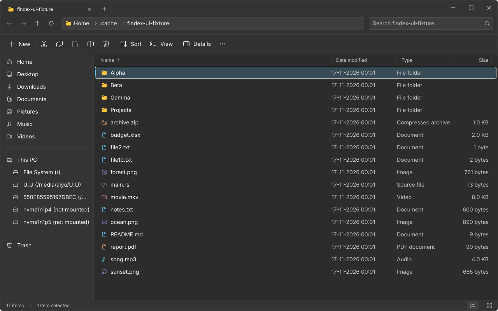
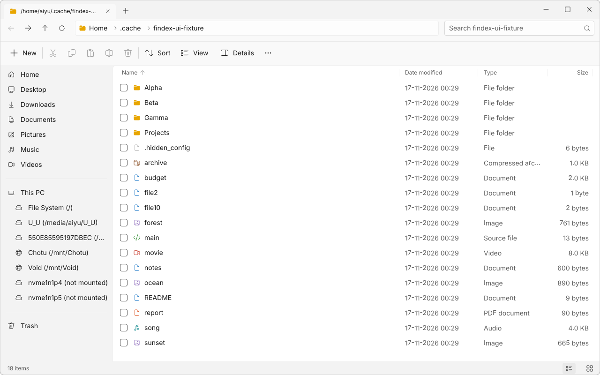
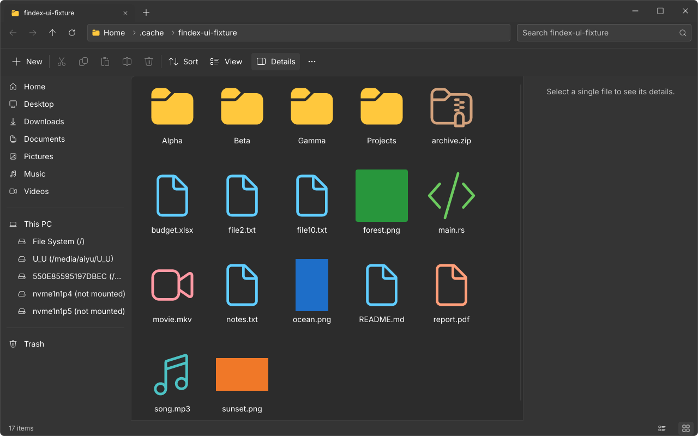
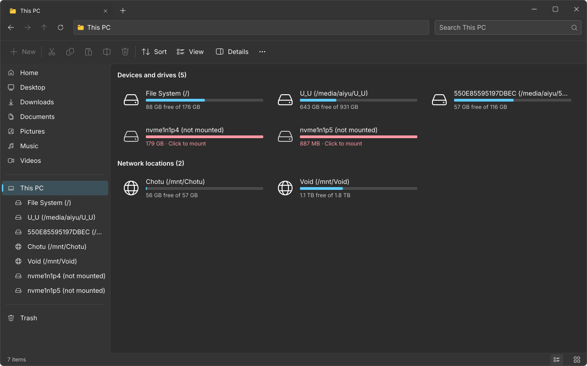
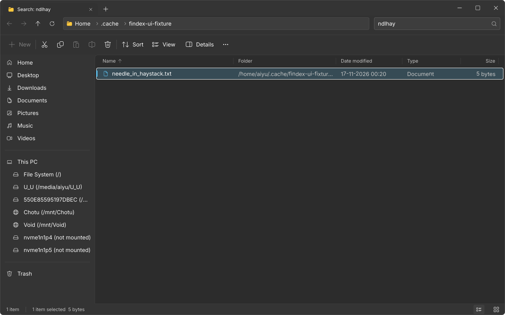
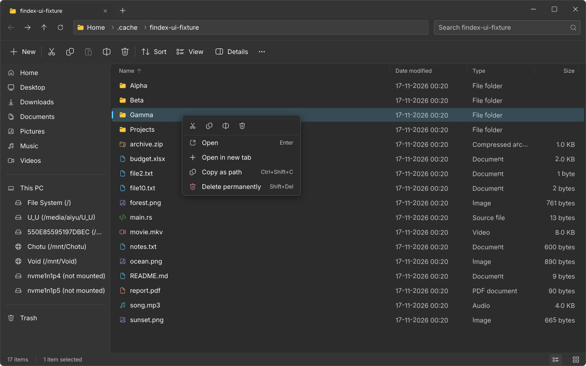
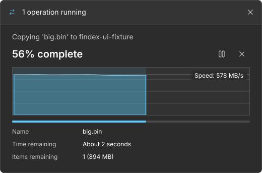
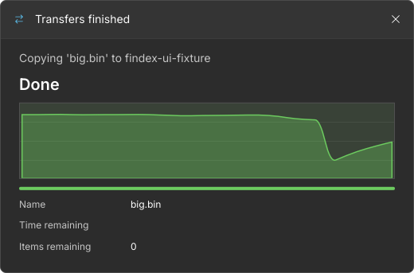
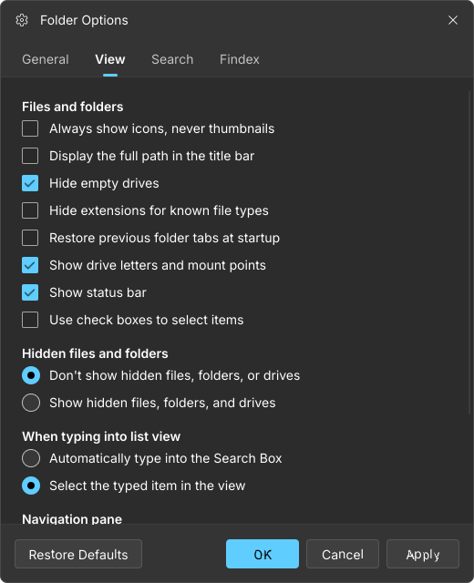
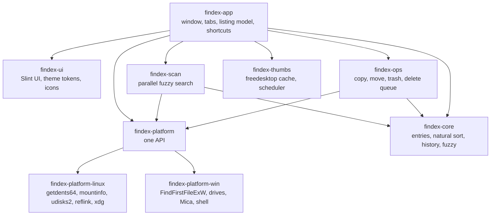

# Findex for Linux and Windows

[](https://github.com/aiyu-ayaan/Switchboard-Rust/actions/workflows/ci.yml)
[](https://github.com/aiyu-ayaan/Switchboard-Rust/releases)
[](https://github.com/aiyu-ayaan/Switchboard-Rust/commits/master)


The desktop edition of [Findex](https://github.com/aiyu-ayaan/Findex), the Android file explorer. A fast, native file explorer written in Rust that looks and feels like the **Windows 11 File Explorer**, on Linux and on Windows: tabs, every Explorer view mode, fuzzy search across subfolders, thumbnails, a Folder Options window, light and dark themes with translucent Mica-style surfaces, and one transfer window for every copy, move and delete. It can be set as the default file manager, so folders and **Super+E** open in Findex.

> **Status: early alpha.** Linux is built and tested end to end (GNOME, X11). The Windows build compiles in CI but has not been run on real hardware yet. Mica, the Win+E hook and default-app registration on Windows are still open (see the roadmap).

---

## 📸 Screenshots

<p align="center">
  
  &nbsp;
  
</p>

<p align="center">
  
  &nbsp;
  
</p>

<p align="center">
  
  &nbsp;
  
</p>

<p align="center">
  
  &nbsp;
  
  &nbsp;
  
</p>

All screenshots come from the end-to-end UI test runs (`tests/ui`).

---

## ✨ Features

### Explore
- **Windows 11 layout**: tabs merged with the title bar, command bar, breadcrumb address bar, navigation pane, details pane, status bar.
- **All eight Explorer views**: extra large, large, medium and small icons, list, details, tiles, content (`Ctrl+Shift+1` to `8`). Every view is virtualized, so huge folders scroll smoothly.
- **Tabs**: new, close, switch (`Ctrl+T`, `Ctrl+W`, `Ctrl+Tab`), middle-click to close, open a folder in a new tab, restore tabs at startup.
- **Streaming listing**: `getdents64` on Linux and `FindFirstFileExW` (large fetch) on Windows. First rows show before the folder finishes loading.
- **Natural sort** (`file2` before `file10`) by name, date, type or size, folders first.
- **Keyboard first**: arrows, Home/End, PageUp/PageDown, Shift/Ctrl selection, type-ahead, Enter, Backspace, Alt+arrows, F2, F5, Delete, `Ctrl+L`, `Ctrl+F`, `Ctrl+A`, `Ctrl+Z`.
- **Thumbnails** for images, shared with Nautilus and Dolphin through the freedesktop thumbnail cache, generated visible-first.

### Search
- **Fuzzy search** (the `nucleo` matcher from Helix) over the current folder and all subfolders. The walk is parallel and breadth-first, and results stream in ranked by match quality.
- Symbolic links and pseudo file systems (`/proc`, `/sys`, ...) are never entered.

### Files
- **One transfer window** for copy, move, trash and delete: large "% complete", a speed graph that fills with progress, a progress bar, speed, time and items remaining, and pause, resume and cancel.
- Reflink (`FICLONE`), then `copy_file_range`, then buffered copy on Linux. Same-volume moves are renames.
- Name clashes keep both (`a - Copy.txt`) and nothing is overwritten. Folders can't be copied into themselves.
- Delete goes to the Trash, with **Undo**. `Shift+Delete` asks first, with the safe button focused.
- New folder and new text document, rename, copy as path, cut and paste between tabs.

### Drives
- **This PC** shows mounted volumes, removable drives, network shares (NFS, SMB, SSHFS, GVfs) and **unmounted partitions** (click to mount through udisks2), with usage bars and a low-space warning.
- Every free-space probe is timeout-guarded, so a dead network share can't freeze the app.

### Look and feel
- **Light and dark** themes that follow the system, or are set by hand.
- **Transparency effects**: translucent Mica-style window and layers. On Windows 11 it asks for the real Mica backdrop.
- Fluent System Icons, Inter / Segoe UI Variable, 4 px grid, 100 / 167 / 250 ms motion that turns off with reduced motion, visible focus rings, and colour never used as the only signal.

### Folder Options (like Explorer's)
- **General**: open to Home or This PC, open folders in the same or a new tab, single- or double-click to open.
- **View**: never thumbnails, full path in the title, hide empty drives, hide known extensions, restore tabs, drive letters and mount points, status bar, check boxes, hidden files, typing goes to the search box or selects, navigation pane sections.
- **Search**: subfolders, hidden files.
- **Findex**: theme, transparency, compact view, default file manager.

---

## ⬇️ Install

**Linux (x86_64)**, no root needed. This installs the AppImage, the Findex logo at every size and a menu entry in your home folder:

```
curl -fsSL https://raw.githubusercontent.com/aiyu-ayaan/Switchboard-Rust/master/scripts/install-linux.sh | sh
```

Add `-s -- --set-default` to also make Findex the default file manager (folders and Super+E on GNOME open Findex). Use `-s -- --channel beta` for beta builds, `-s -- --version 0.0.1` for one release, or `-s -- --uninstall` to remove it. Run it again to update. The `.deb` and the Windows build are on the [Releases](https://github.com/aiyu-ayaan/Switchboard-Rust/releases) page.

Default file manager from the app: **See more (⋯) > Options > Findex**, or `findex --set-default`. Undo with `findex --repair`, which restores the previous handler.

---

## 🧭 How it works



The UI thread never touches the disk. Listing, sorting, search, thumbnails, drive probes and file operations run on worker threads, and every one of them can be cancelled. Platform code lives only in the `findex-platform-*` crates.

Design docs are in [`development/docs`](development/docs): architecture, features, platform integration, performance budgets, cleanup and thumbnails, UI design language, roadmap and releases.

---

## 🚀 Build

```bash
# Linux needs: libfontconfig1-dev libxkbcommon-dev libwayland-dev libx11-dev libgl1-mesa-dev
cargo run -p findex-app -- ~/Documents      # run
cargo test --workspace                      # unit tests
tests/ui/run.sh                             # end-to-end UI suites (needs a display; CI uses Xvfb)
cargo build --release -p findex-app && scripts/package-linux.sh   # AppImage + .deb in dist/
```

`findex --search ROOT QUERY` runs the fuzzy search from the command line and prints the time it took.

## 🏷️ Releases

Same flow as Domus: put `!alpha`, `!beta`, `!stable`, `!fix`, `!feat` or `!major` at the start of a commit subject on `master`. That opens a release PR, and merging the PR builds and publishes. Details: [`development/docs/09-release.md`](development/docs/09-release.md).

## Licence

Apache License 2.0. See [LICENSE](LICENSE).
